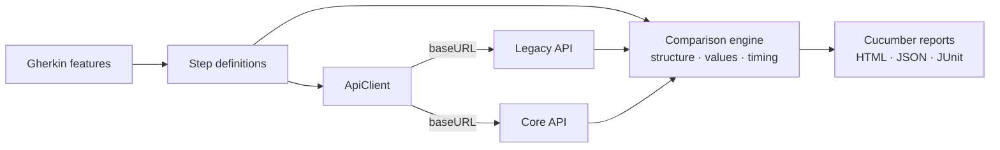

# API Migration Test

BDD test framework for validating an **API migration** — a legacy service being replaced by a new
"Core" implementation. It answers three questions for every endpoint:

1. **Does Core honour the contract?** (status codes, JSON Schema, error handling)
2. **Is Core a faithful replacement for Legacy?** (same structure, same values, same error messages)
3. **Is Core fast enough?** (side-by-side timing with an optional regression gate)

The repository ships with two small **mock APIs** (Legacy and Core) so that anyone can clone it and
run the whole suite in seconds, with no credentials and no external services. Core intentionally
diverges from Legacy on one endpoint, so you can see what a failing comparison looks like.

> All endpoints, data, names and credentials in this repository are fictional.

## Stack

Cucumber (Gherkin) · TypeScript · Playwright `APIRequestContext` · Ajv (JSON Schema) · Node.js ≥ 20

## How it works



The same step definitions drive both APIs. A custom `{api}` parameter type lets a scenario say
_"from the Legacy API"_ or _"from the Core API"_, and each scenario holds one HTTP session per API,
so a comparison scenario simply calls both and diffs the results.

### Comparison engine (`src/utils/compare.ts`)

| Check              | What it does                                                                                                                                                                            |
| ------------------ | --------------------------------------------------------------------------------------------------------------------------------------------------------------------------------------- |
| **Structure**      | Same keys, same types, same first-letter casing (`ListingId` ≠ `listingId`, a breaking change for consumers). Extra keys in Core are reported but do not fail; keys missing in Core do. |
| **Values**         | Deep value comparison. Volatile fields (timestamps, audit columns, tokens) are skipped through an ignore-list. `null` vs a real value **is** a difference.                              |
| **Error messages** | Compares the `Message` of failure responses, so validation behaviour is preserved.                                                                                                      |
| **Performance**    | Runs N iterations against each API and reports average / min / max / median, plus an optional gate: _"Core must not be more than X % slower than Legacy"_.                              |

## Quick start

```bash
npm install
npm test
```

`npm test` starts the bundled mock APIs automatically (Core on `:4010`, Legacy on `:4011`), runs
every scenario except the known divergence, and writes reports to `reports/`.

| Command                   | Runs                                                              |
| ------------------------- | ----------------------------------------------------------------- |
| `npm test`                | Everything except `@ignore` and `@known-divergence`               |
| `npm run test:smoke`      | `@smoke` — Core contract checks                                   |
| `npm run test:comparison` | `@comparison` — Legacy vs Core diffing and timing                 |
| `npm run test:divergence` | `@known-divergence` — **expected to fail**, shows the diff report |
| `npm run report`          | Serves `reports/` and opens the HTML report in your browser       |
| `npm run test:report`     | Runs the suite, then serves the fresh report                      |
| `npm run mock`            | Starts only the mock APIs (handy for Postman / curl)              |
| `npm run typecheck`       | TypeScript type check                                             |

After a run, `npm run report` opens the full HTML report at `http://localhost:5000`
(`npm run report -- --port 8080` to change the port, `-- --no-open` to skip launching the browser).

## What a detected divergence looks like

The mock Core API returns `OwnerId: null` and a camelCase `listingDetailLink` key for a listing.
`npm run test:divergence` reports:

```text
Core is missing structure present in Legacy (1):
  - root.Data.ListingDetailLink: casing mismatch (Legacy: "ListingDetailLink", Core: "listingDetailLink")

Value differences between Legacy and Core (1):
  - root.Data.OwnerId: value mismatch (Legacy: "usr-0001", Core: null)
```

`DateCreated` differs on every call and is ignored by design.

## Project layout

```text
features/                 Gherkin scenarios, one folder per API area
  health.feature
  token.feature
  listing/                getCategories, getListingDetail
  account/                register
mock/server.mjs           Zero-dependency Legacy + Core mock APIs
scripts/serve-report.mjs  Serves the generated reports (`npm run report`)
src/
  clients/ApiClient.ts    HTTP wrapper (auth header, content types, relative URLs)
  support/                config, world, hooks, timed calls
  steps/                  Step definitions (common, token, listing, account, comparison)
  schemas/                JSON Schemas used by "the response should match the schema"
  utils/                  compare.ts, performance.ts, schema.ts
.github/workflows/ci.yml  Installs, type-checks and runs the suite on every push
```

## Testing real APIs instead of the mock

```bash
cp .env.example .env
# edit .env:
#   USE_EXTERNAL_API=true
#   API_CORE_URL=https://core.example.com
#   API_LEGACY_URL=https://legacy.example.com
#   TEST_USER / TEST_PASSWORD
npm test
```

Credentials are read from the environment and `.env` is git-ignored. In CI, store them as secrets.

## Adding a new endpoint

1. Add a step in `src/steps/` that calls `callTimed(this, api, () => client.get(...))`.
2. Add a schema in `src/schemas/` if the response has a payload.
3. Write a feature with Core contract scenarios (`@smoke`) and a Legacy-vs-Core scenario
   (`@comparison`) that ends with the structure / values / performance steps.

Tagging conventions: `@smoke`, `@comparison`, `@known-divergence` (documented, not yet fixed),
`@flaky` (retried), `@ignore` (skipped).

## Design notes

- **One session per API per scenario.** Isolation without global state; both sessions are disposed
  in the `After` hook, which also attaches the last response of each API when a scenario fails.
- **Self-contained by default.** The mock starts in `BeforeAll`, so a fresh clone is green with a
  single command — and the same suite points at real environments through environment variables.
- **Known divergences stay in the suite.** They are tagged instead of deleted, so the tracked gap
  between Legacy and Core is executable and visible.

## License

MIT
